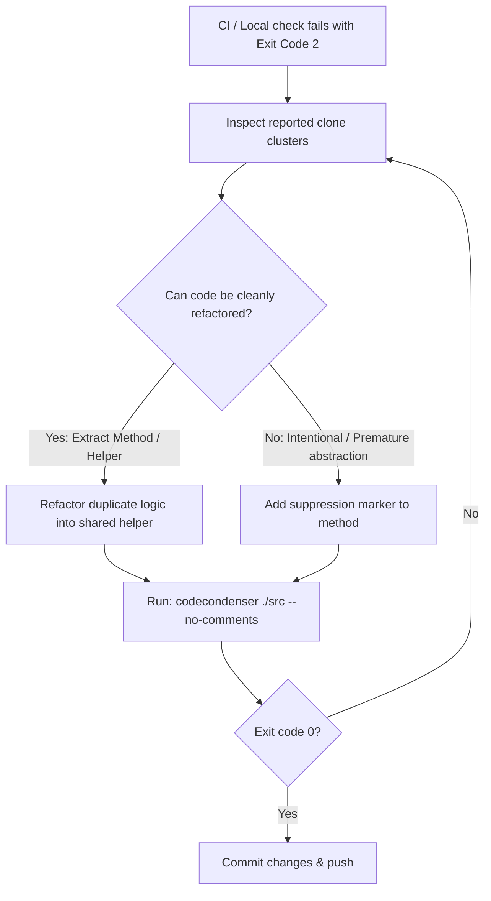

# CodeCondenser Agent Skill

`Pmad.CodeCondenser` (`codecondenser`) is a .NET 10 Roslyn-based static analysis tool designed to:
1. **Detect Type-2 Structural Code Clones**: Identifies duplicate logic across C# methods (ignoring variable, parameter, and literal renames) without requiring an LLM.
2. **Compact Repeated Inline Strings**: Detects string literals >= 100 characters used more than once, with estimated character/token savings, minimal constant declaration snippets, and typical usage patterns. Also identifies inline strings matching existing `const` or `static readonly` string constants (with a lower default threshold of >= 20 characters) and recommends referencing the existing constant instead.
3. **Condense Verbose Comments**: Shortens oversized single-line, multi-line, and XML documentation comments into clean, concise summaries formatted to 120 columns using an LLM.
4. **Enforce Single Type Per File**: Automatically ensures each class, interface, struct, enum, record, or delegate has its own `.cs` file matching its type name (with line tolerance for small inline types like 1-line delegates) to optimize AI agent context window loading.
5. **Detect Lines of Code Limits**: Flags methods (> 150 LOC) and classes/records (> 1500 LOC) exceeding maintainability thresholds, excluding comments and blank lines (report-only, no auto-fix).
6. **Detect Predicate / Boolean Condition Clones**: Identifies duplicate complex boolean conditions across `if`, ternary, `while`, `do`, `return`, and LINQ calls (e.g. `.Where(...)`, `.Any(...)`) with >= 100 characters. Automatically matches conditions against existing static or instance helper methods/properties (>= 20 characters), handling receiver binding (`slot.IsOnline(...)`), parameter reordering, constant/enum folding, and De Morgan logical negations (`!slot.IsOnline(...)`).
7. **Modernize High-Impact Condensation Patterns**: Identifies verbose legacy framework calls and C# idioms (e.g. `s.Replace("\r\n", "\n").Replace("\r", "\n")`, `string.IsNullOrEmpty(s.Trim())`, `x != null ? x : fallback`, `arg == null throw new ArgumentNullException`, `s.IndexOf(...) >= 0`, `OrderBy(...).First()`) and automatically rewrites them with `codecondenser apply`.
8. **Enforce Guardrails in CI**: Compares changes incrementally against a baseline snapshot and exits with code `2` when new duplication, repeated strings, type violations, lines of code violations, or predicate clones are introduced.

---

## Quick Reference: CLI Commands

The CLI can be invoked via the global tool `codecondenser`, local tool `dotnet codecondenser`, or from source `dotnet run --project src/Pmad.CodeCondenser.Cli --`.

| Task | Command | AI Backend Needed? |
| :--- | :--- | :---: |
| **Status report of types, clones, patterns, predicates, LOC & comments** | `codecondenser report ./src` | No |
| **Check clones only (disable comments, strings, types, LOC, predicates & patterns)** | `codecondenser analyze ./src --no-comments --no-strings --no-type-split --no-loc --no-predicates --no-patterns` | No |
| **Limit displayed results to top N with largest benefit** | `codecondenser report ./src --limit 10` | No |
| **Check production code only (skip tests)** | `codecondenser analyze ./ --exclude-tests --no-comments` | No |
| **Target specific .NET TFM for pattern rules** | `codecondenser report ./src --patterns-tfm 8.0` | No |
| **Filter specific pattern rules (e.g. PCC401, PCC405)** | `codecondenser report ./src --pattern-rules PCC401,PCC405` | No |
| **Incremental CI check (strict guardrails: clones + comments + strings + types + LOC + predicates)** | `codecondenser analyze ./ --incremental --duplication-tolerance 0 -ct 0 -st 0 -tt 0 -lt 0 -pt 0` | No |
| **Export SARIF report for GitHub Actions** | `codecondenser analyze ./src --format sarif --output results.sarif` | No |
| **Export structured JSON report** | `codecondenser analyze ./src --format json --output results.json` | No |
| **Summarize comments using LLM** | `codecondenser analyze ./src -m gemma4:e4b` | Yes (Ollama) |
| **Apply type splits, condensation patterns & comments to disk** | `codecondenser apply ./src` | No (deterministic/cache) |
| **Apply condensation patterns only** | `codecondenser apply ./src --no-comments --no-type-split` | No |
| **Refresh baseline snapshot** | `codecondenser snapshot ./src` | No |
| **Install/update workspace agent skills** | `codecondenser skills [path]` | No |
| **Install agent skills globally** | `codecondenser skills --global` | No |
| **Measure code tokens (total, comments, code)** | `codecondenser measure ./src` | No |
| **Measure code tokens with specific estimator** | `codecondenser measure ./src --estimator qwen` | No |

> [!NOTE]
> **Summary Modes**:
> - **`report`** (default if no LLM configured, or `codecondenser report` / `--summary report`): Extracts verbose comments and structural clones, outputting tips, refactoring recommendations, and suppression guidance without calling an LLM.
> - **`summarize`** (default if LLM is configured, or `--summary summarize`): Uses LLM to condense verbose comments and caches summaries for WYSIWYG application.
> - **`disabled`** (`--no-comments` / `--summary disabled`): Disables comment extraction and summarization entirely.

> [!NOTE]
> **Default Test & Generated Code Filtering**:
> - Auto-generated files (`*.Designer.cs`, `*.g.cs`, `*.generated.cs`, `*ModelSnapshot.cs`, `**/Migrations/**`, and files with `<auto-generated>` header comments) are skipped automatically.
> - By default, test clones are reported under a separate section for review (balancing DAMP vs DRY), but do **not** trigger CI failure unless `--enforce-test-duplication` is passed or configured in `codecondenser.json`.
> - Pass `--exclude-tests` (or `--production-only`) to skip test suites entirely.

---

## Agent Decision Tree & Workflows

### Workflow 1: Pre-PR / Pre-Commit Check (Report Mode)
Before finalizing changes or opening a PR, run a status check for accidental code duplication and verbose comments:
```bash
codecondenser report ./src
```
- If clean (Exit code `0`): Proceed with your workflow.
- If clones or verbose comments detected: Review the recommendations. Refactor, condense, or suppress appropriately (see [Managing Suppressions](#managing-suppressions)).

### Workflow 2: Resolving CI Build Failures (Exit Code `2`)
When CI fails with exit code `2`, new code duplication, new repeated strings, or new verbose comments were introduced exceeding policy tolerance:
1. Run the incremental check locally to view the actionable feedback:
   ```bash
   codecondenser analyze ./src --incremental --duplication-tolerance 0 -ct 0 -st 0
   ```
2. The CLI outputs unified **actionable feedback only once at the end** specifying the exact files, lines, and suppress instructions:
   - For duplication: add `[SuppressMessage("CodeCondenser", "Duplication", Justification = "<why>")]` or `// codecondenser:ignore-duplicate`.
   - For repeated strings: extract into a shared constant (e.g. `internal const string Name = "...";` in a static constants class), or suppress with `[SuppressMessage("CodeCondenser", "RepeatedString")]` or `// codecondenser:ignore-string`.
   - For XML comments: add `condense="no"` (e.g. `<summary condense="no">`).
   - For regular comments: add `// codecondenser:ignore` or `// nocondense`.
3. Follow the [Handling Duplication Violations](#handling-duplication-violations-exit-code-2) procedure below.

### Workflow 3: Comment Condensation (Dry-Run & Apply)
When asked to condense or clean up verbose comments:
1. **Verify Ollama availability**: Ensure Ollama is running or use a cloud model:
   ```bash
   # Local model:
   codecondenser analyze ./src -m gemma4:e4b
   # Or cloud model (zero local VRAM):
   codecondenser analyze ./src -m gpt-oss:20b-cloud
   # Or with global config (%APPDATA%\CodeCondenser\codecondenser.json on Windows, ~/.codecondenser/codecondenser.json on Linux/macOS):
   codecondenser analyze ./src --summary summarize
   ```
2. **Review proposed summaries & retry behavior**:
   - The dry run saves proposed summaries to `.codecondenser/snapshot.json` without modifying files on disk.
   - **Automated Retry Loop**: If a candidate summary is longer than before, or if reduction is above target threshold and above 50% of the initial comment length, the summarizer automatically retries (configurable via `--max-retries <n>` or `-mr <n>`, default: 1, clamped 0–5). On retry, the model is explicitly instructed to drop secondary details and minor caveats to achieve brevity.
   - **Useless Comments**: The LLM is instructed to answer `"Comment is useless"` if a regular comment fails to explain 'why' (e.g. merely restates code syntax) or if an XML doc comment fails to explain 'what'. When detected, applying changes removes the comment completely, granting 100% reduction credit.
3. **Apply changes**:
   ```bash
   codecondenser apply ./src
   ```
   *WYSIWYG Guarantee*: `apply` uses the exact summaries cached during the dry run; no secondary LLM calls are made.
4. **Git hygiene**:
   - Commit `.codecondenser/summarized-comments.json` (prevents re-analyzing already condensed comments).
   - Ensure `.codecondenser/snapshot.json` is ignored in `.gitignore`.

### Workflow 4: Measuring Codebase in LLM Tokens
When estimating context window usage or assessing codebase token footprint for AI coding agents:
```bash
# Standard measurement across production and test code
codecondenser measure ./src

# Using a specific token estimator preset (default, qwen, gemma)
codecondenser measure ./src --estimator qwen

# Exporting measurement data in JSON format
codecondenser measure ./src --format json -o tokens.json
```
The `measure` verb returns:
- **Total tokens**: Total estimated tokens in the codebase.
- **Comments tokens**: Tokens consumed by inline, multi-line, and XML doc comments.
- **Code tokens**: Tokens consumed by actual code excluding comments.
- Broken down per category: **Production**, **Tests**, and overall **Total**.
- *Important*: The token estimator choice is a specific setting (`--estimator` / `-te` / `"tokenEstimator"`, using `Pmad.AI.HeuristicTokenEstimator`), **not** `Ollama.Model` (which is exclusively reserved for LLM comment summarization). Estimation is local, instantaneous, and requires no backend service.

---

## Managing Suppressions

When code duplication or comment verbosity is intentional, you must apply the appropriate suppression marker.

### 1. Duplication (Code Clone) Suppressions

Use duplication suppressions when duplicate methods are intentional (e.g., protocol handlers, SIMD variations, boilerplate builders, generated patterns) and refactoring would hurt readability or performance.

#### Option A: C# Attributes on Methods (Recommended for Public APIs)
Use `[SuppressMessage]` or `[CodeCondenserIgnore]` on the method:
```csharp
using System.Diagnostics.CodeAnalysis;

// Standard .NET SuppressMessage attribute:
[SuppressMessage("CodeCondenser", "Duplication", Justification = "Intentional protocol packet parser")]
public void ParseHeader(byte[] buffer)
{
    // ...
}

// Or dedicated attribute:
[CodeCondenserIgnore]
public void SerializePayload(Span<byte> destination)
{
    // ...
}
```
*Supported attribute names*: `CodeCondenserIgnore`, `NoClone`, `IgnoreDuplication`, `IgnoreClone`, `SuppressDuplication`, or `SuppressMessage` with category/id containing `"codecondenser"`, `"duplicate"`, `"duplication"`, or `"clone"`.

#### Option B: Comment Markers Above Method
Add a comment marker in the leading trivia directly above the method (or above its attributes):
```csharp
// codecondenser:ignore-duplicate
public void ProcessRecordA(Record record)
{
    // ...
}
```
*Accepted markers*: `// codecondenser:ignore-duplicate`, `// codecondenser:ignore`, `// codecondenser:ignore-duplication`, `// codecondenser:ignore-clone`, `// no-clone`, `// noclone`, `// nocondense`.

#### Option C: Comment Markers Inside Method Body
Place the marker anywhere inside the method's body:
```csharp
public void ProcessRecordB(Record record)
{
    // codecondenser:ignore-duplicate
    // ...
}
```

---

### 2. Comment Suppressions

Use comment suppressions when a detailed comment, legal disclaimer, complex algorithmic explanation, or domain model documentation must remain in full length and should not be condensed.

#### Regular Comments (`//` and `/* */`)
- **Preceding Line**: Place `// codecondenser:ignore` (or `// nocondense`) on the line directly preceding the comment:
  ```csharp
  // codecondenser:ignore
  // This comment contains an elaborate explanation of the IEEE 754 floating point
  // edge cases encountered in the coordinate conversion formula below.
  double normalized = Math.Round(raw * ScaleFactor, MidpointRounding.AwayFromZero);
  ```
- **Inline / Within Comment**: Embed the marker anywhere inside the comment:
  ```csharp
  /* nocondense: The following lookup table is precomputed from NIST publication SP 800-22 */
  ```
*Accepted markers*: `codecondenser:ignore`, `codecondenser:ignore-comment`, `codecondenser-ignore`, `nocondense`.

#### XML Documentation Comments (`///`)
Add a suppression attribute to the XML tag (`<summary>`, `<remarks>`, or `<param>`):
```csharp
/// <summary condense="no">
/// Extremely detailed summary that should never be condensed by the LLM.
/// Preserves detailed architectural reasoning and references.
/// </summary>
/// <remarks condense="no">
/// Extensive usage notes and thread-safety caveats.
/// </remarks>
/// <param name="options" condense="no">Comprehensive configuration parameter explanation.</param>
public void ConfigurePipeline(PipelineOptions options)
```
*Accepted XML attributes and values*:
- `condense="no"` (or `"false"`, `"never"`, `"none"`, `"off"`)
- `nocondense="true"` (or `"yes"`, `"1"`, or simply `nocondense`)
- `codecondenser="ignore"`

#### Persistent Comment Store (`.codecondenser/summarized-comments.json`)
When comments are summarized and applied via `apply`, their SHA256 hashes are automatically saved into `.codecondenser/summarized-comments.json`.
- **Do NOT delete** this file.
- **Always commit** this file to Git.
- CodeCondenser reads this file to skip re-flagging previously summarized comments, even if their length still exceeds thresholds.

---

### 3. Repeated Inline String Suppressions

Use repeated string suppressions when a long string literal must intentionally remain inline (e.g. SQL query, test payload, code generation template):
- **Comment Marker**: Place `// codecondenser:ignore-string` (or `// nocondense`) on the line preceding or inline with the string literal.
- **Attribute**: Apply `[SuppressMessage("CodeCondenser", "RepeatedString")]` to the enclosing method or class.

#### Existing Constant Recommendation
When an inline string matches an existing `const string` or `static readonly string` defined in the codebase, CodeCondenser detects it using a lower threshold (default: 20 characters, configurable via `--threshold-existing-constants` / `-tec`) and recommends referencing that existing constant directly (zero declaration overhead):
- Output recommendation: `Use existing constant '<TypeName>.<ConstantName>' instead of inline value.`
- SARIF diagnostic: Flags the inline occurrence with rule `CC006` and links the existing constant declaration as a related location.

#### New Constant Extraction Pattern
When no existing constant exists and a string is repeated >= 100 characters, minimal constant declaration pattern recommended:
```csharp
namespace ApplicationNamespace;

static class Constants
{
    internal const string NameOfMyConstant = "...";
}
```
Typical usage:
`Constants.NameOfMyConstant`

---

### 4. Single Type Per File Suppressions

When an auxiliary type must intentionally remain in the same file as another type (beyond the configured line tolerance):
- **Comment Marker**: Place `// codecondenser:ignore-type-split` or `// codecondenser:ignore` on the line directly preceding the secondary type declaration.
- **Attribute**: Apply `[SuppressMessage("CodeCondenser", "SingleTypePerFile")]` or `[SingleTypePerFileIgnore]` to the secondary type declaration.

*Note*: Types declared with the C# 11 `file` modifier or types within the line tolerance (default: 1 line, e.g. 1-line delegates) are automatically tolerated and never split.

---

### 5. Lines of Code Limits Suppressions

When a large method or class must intentionally remain above configured limits (e.g. state machines, large parser switches, complex algorithms):
- **Comment Marker**: Place `// codecondenser:ignore-loc` (or `// noloc`) on the line directly preceding the method or class declaration.
- **Attribute**: Apply `[SuppressMessage("CodeCondenser", "MethodLength")]` or `[SuppressMessage("CodeCondenser", "ClassLength")]` (or rule-wide `[SuppressMessage("CodeCondenser", "LinesOfCode")]` / `[LinesOfCodeIgnore]`) to the declaration.

---

### 6. Predicate / Boolean Condition Suppressions

When a complex boolean condition must intentionally remain inline:
- **Comment Marker**: Place `// codecondenser:ignore-predicate` (or `// nopredicate`, `// codecondenser:ignore`) on the line preceding or inline with the condition.
- **Attribute**: Apply `[SuppressMessage("CodeCondenser", "PredicateDuplication")]` (CC010) or `[SuppressMessage("CodeCondenser", "PredicateMatchesExistingHelper")]` (CC011) to the enclosing method or class.

#### Existing Helper Recommendation (CC011)
When an inline condition matches an existing helper method or property (e.g., `slot.State == Online && now - slot.CachedAt <= ttl` matching `slot.IsOnlineWithinTtl(now, ttl)`):
- CodeCondenser detects it using a threshold of >= 20 characters (configurable via `--threshold-existing-helpers` / `-thelp`).
- Output recommendation: `Replace inline condition with 'slot.IsOnlineWithinTtl(...)'.`
- Supports instance receiver binding (`$this`), static parameters, and De Morgan negations (`!slot.IsOnlineWithinTtl(...)`).

#### Duplicate Condition Extraction Pattern (CC010)
When duplicate conditions exist without an existing helper (>= 100 characters, configurable via `--threshold-predicates` / `-tpred`):
- CodeCondenser recommends extracting the condition into a shared helper method (e.g., in a shared static helper class `PredicateHelpers`).

---

### 7. Condensation Pattern Suppressions

When a legacy or verbose syntax pattern must intentionally be preserved (e.g. to avoid newer framework APIs or keep explicit null checks):
- **Comment Marker**: Place `// codecondenser:ignore-pattern:<ruleId>` (e.g. `// codecondenser:ignore-pattern:PCC401`, `// codecondenser:ignore-pattern:PCC401,PCC402`) or general `// codecondenser:ignore` / `// nocondense` on the line directly preceding the pattern or statement.
- **Attribute**: Apply `[SuppressMessage("CodeCondenser", "<ruleId>")]` (e.g. `[SuppressMessage("CodeCondenser", "PCC401")]`), `[CodeCondenserIgnore]`, or `[IgnorePattern]` to the enclosing member or class.

---

## Handling Duplication Violations (Exit Code `2`)

When the incremental clone check fails with exit code `2`, execute the following step-by-step resolution plan:



### Step 1: Read the Cluster Report
The CLI prints the exact file paths, line ranges, and normalized syntax for every duplicate cluster.

### Step 2: Refactor or Suppress
1. **Refactor (Preferred)**:
   - If two methods share identical structural logic, extract the common algorithm into a private helper or utility method.
   - Use generics or delegates/lambdas to parameterize minor type differences.
2. **Suppress (When Appropriate)**:
   - If the methods are in distinct modules where coupling them via a shared helper would create an undesirable dependency.
   - If the duplication is standard boilerplate (e.g., entity builders, switch statements on different enums, protocol serialization).
   - Add `// codecondenser:ignore-duplicate` or `[SuppressMessage("CodeCondenser", "Duplication")]`.

### Step 3: Validate
Re-run the check to ensure all violations are resolved:
```bash
codecondenser ./src --incremental --duplication-tolerance 0 --no-comments
```

---

## Reference Documentation

For deeper details, consult the following reference documents:
- [Detailed Suppression Reference](./references/suppressions.md) - Exact regexes, syntax trees, and edge case handling.
- [CLI & Configuration Reference](./references/cli-reference.md) - All CLI flags, config file schema (`codecondenser.json`), and CI recipes.
- [Agent Scenario Walkthroughs](./examples/agent-scenarios.md) - Concrete examples of agents resolving violations and applying summaries.
