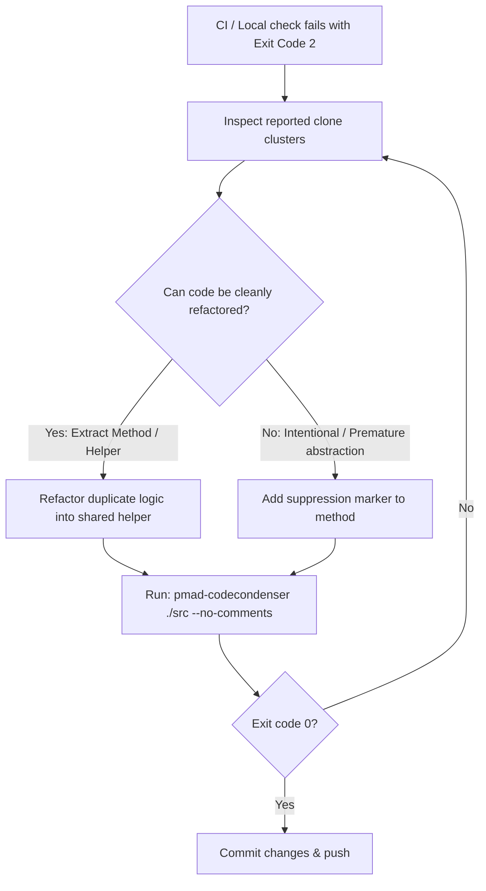

# CodeCondenser Agent Skill

`Pmad.CodeCondenser` (`pmad-codecondenser`) is a .NET 10 Roslyn-based static analysis tool designed to:
1. **Detect Type-2 Structural Code Clones**: Identifies duplicate logic across C# methods (ignoring variable, parameter, and literal renames) without requiring an LLM.
2. **Condense Verbose Comments**: Shortens oversized single-line, multi-line, and XML documentation comments into clean, concise summaries formatted to 120 columns using an LLM.
3. **Enforce Duplication Guardrails in CI**: Compares changes incrementally against a baseline snapshot and exits with code `2` when new duplication is introduced.

---

## Quick Reference: CLI Commands

The CLI can be invoked via the global tool `pmad-codecondenser`, local tool `dotnet pmad-codecondenser`, or from source `dotnet run --project src/Pmad.CodeCondenser.Cli --`.

| Task | Command | AI Backend Needed? |
| :--- | :--- | :---: |
| **Check clones & comments (Report mode - default)** | `pmad-codecondenser ./src` | No |
| **Check clones only (disable comments)** | `pmad-codecondenser ./src --no-comments` | No |
| **Check production code only (skip tests)** | `pmad-codecondenser ./ --exclude-tests --no-comments` | No |
| **Incremental CI check (strict duplication + comments)** | `pmad-codecondenser ./ --incremental --duplication-tolerance 0 -ct 0` | No |
| **Incremental CI check (strict duplication only)** | `pmad-codecondenser ./ --incremental --duplication-tolerance 0` | No |
| **Export SARIF report for GitHub Actions** | `pmad-codecondenser ./src --format sarif --output results.sarif` | No |
| **Export structured JSON report** | `pmad-codecondenser ./src --format json --output results.json` | No |
| **Summarize comments using LLM** | `pmad-codecondenser ./src -m gemma4:e4b` | Yes (Ollama) |
| **Apply summarized comments to disk** | `pmad-codecondenser ./src --apply` | No (uses cache) |
| **Refresh baseline snapshot** | `pmad-codecondenser snapshot ./src` | No |

> [!NOTE]
> **Summary Modes**:
> - **`report`** (default if no LLM configured, or `--report-only` / `--summary report`): Extracts verbose comments and structural clones, outputting tips, refactoring recommendations, and suppression guidance without calling an LLM.
> - **`summarize`** (default if LLM is configured, or `--summary summarize`): Uses LLM to condense verbose comments and caches summaries for WYSIWYG application.
> - **`disabled`** (`--no-comments` / `--summary disabled`): Disables comment extraction and summarization entirely.

> [!NOTE]
> **Default Test & Generated Code Filtering**:
> - Auto-generated files (`*.Designer.cs`, `*.g.cs`, `*.generated.cs`, `*ModelSnapshot.cs`, `**/Migrations/**`, and files with `<auto-generated>` header comments) are skipped automatically.
> - By default, test clones are reported under a separate section for review (balancing DAMP vs DRY), but do **not** trigger CI failure unless `--enforce-test-duplication` is passed or configured in `codecondenser.json`.
> - Pass `--exclude-tests` (or `--production-only`) to skip test suites entirely.

---

## Agent Decision Tree & Workflows

### Workflow 1: Pre-PR / Pre-Commit Check (Report Mode)
Before finalizing changes or opening a PR, run a dry-run check for accidental code duplication and verbose comments:
```bash
pmad-codecondenser ./src
```
- If clean (Exit code `0`): Proceed with your workflow.
- If clones or verbose comments detected: Review the recommendations. Refactor, condense, or suppress appropriately (see [Managing Suppressions](#managing-suppressions)).

### Workflow 2: Resolving CI Build Failures (Exit Code `2`)
When CI fails with exit code `2`, new code duplication or new verbose comments were introduced exceeding policy tolerance:
1. Run the incremental check locally to view the actionable feedback:
   ```bash
   pmad-codecondenser ./src --incremental --duplication-tolerance 0 -ct 0
   ```
2. The CLI outputs unified **actionable feedback only once at the end** specifying the exact files, lines, and suppress instructions:
   - For duplication: add `[SuppressMessage("CodeCondenser", "Duplication", Justification = "<why>")]` or `// codecondenser:ignore-duplicate`.
   - For XML comments: add `condense="no"` (e.g. `<summary condense="no">`).
   - For regular comments: add `// codecondenser:ignore` or `// nocondense`.
3. Follow the [Handling Duplication Violations](#handling-duplication-violations-exit-code-2) procedure below.

### Workflow 3: Comment Condensation (Dry-Run & Apply)
When asked to condense or clean up verbose comments:
1. **Verify Ollama availability**: Ensure Ollama is running or use a cloud model:
   ```bash
   # Local model:
   pmad-codecondenser ./src -m gemma4:e4b
   # Or cloud model (zero local VRAM):
   pmad-codecondenser ./src -m gpt-oss:20b-cloud
   ```
2. **Review proposed summaries**: The dry run saves proposed summaries to `.codecondenser/snapshot.json` without modifying files on disk.
3. **Apply changes**:
   ```bash
   pmad-codecondenser ./src --apply
   ```
   *WYSIWYG Guarantee*: `apply` uses the exact summaries cached during the dry run; no secondary LLM calls are made.
4. **Git hygiene**:
   - Commit `.codecondenser/summarized-comments.json` (prevents re-analyzing already condensed comments).
   - Ensure `.codecondenser/snapshot.json` is ignored in `.gitignore`.

---

## Managing Suppressions

When code duplication or comment verbosity is intentional, you must apply the appropriate suppression marker.

### 1. Duplication (Code Clone) Suppressions

Use duplication suppressions when duplicate methods are intentional (e.g., protocol handlers, SIMD variations, boilerplate builders, generated patterns) and refactoring would hurt readability or performance.

#### Option A: C# Attributes on Methods (Recommended for Public APIs)
Use `[SuppressMessage]` or `[CodeCondenserIgnore]` on the method:
```csharp
using System.Diagnostics.CodeAnalysis;

// Standard .NET SuppressMessage attribute:
[SuppressMessage("CodeCondenser", "Duplication", Justification = "Intentional protocol packet parser")]
public void ParseHeader(byte[] buffer)
{
    // ...
}

// Or dedicated attribute:
[CodeCondenserIgnore]
public void SerializePayload(Span<byte> destination)
{
    // ...
}
```
*Supported attribute names*: `CodeCondenserIgnore`, `NoClone`, `IgnoreDuplication`, `IgnoreClone`, `SuppressDuplication`, or `SuppressMessage` with category/id containing `"codecondenser"`, `"duplicate"`, `"duplication"`, or `"clone"`.

#### Option B: Comment Markers Above Method
Add a comment marker in the leading trivia directly above the method (or above its attributes):
```csharp
// codecondenser:ignore-duplicate
public void ProcessRecordA(Record record)
{
    // ...
}
```
*Accepted markers*: `// codecondenser:ignore-duplicate`, `// codecondenser:ignore`, `// codecondenser:ignore-duplication`, `// codecondenser:ignore-clone`, `// no-clone`, `// noclone`, `// nocondense`.

#### Option C: Comment Markers Inside Method Body
Place the marker anywhere inside the method's body:
```csharp
public void ProcessRecordB(Record record)
{
    // codecondenser:ignore-duplicate
    // ...
}
```

---

### 2. Comment Suppressions

Use comment suppressions when a detailed comment, legal disclaimer, complex algorithmic explanation, or domain model documentation must remain in full length and should not be condensed.

#### Regular Comments (`//` and `/* */`)
- **Preceding Line**: Place `// codecondenser:ignore` (or `// nocondense`) on the line directly preceding the comment:
  ```csharp
  // codecondenser:ignore
  // This comment contains an elaborate explanation of the IEEE 754 floating point
  // edge cases encountered in the coordinate conversion formula below.
  double normalized = Math.Round(raw * ScaleFactor, MidpointRounding.AwayFromZero);
  ```
- **Inline / Within Comment**: Embed the marker anywhere inside the comment:
  ```csharp
  /* nocondense: The following lookup table is precomputed from NIST publication SP 800-22 */
  ```
*Accepted markers*: `codecondenser:ignore`, `codecondenser:ignore-comment`, `codecondenser-ignore`, `nocondense`.

#### XML Documentation Comments (`///`)
Add a suppression attribute to the XML tag (`<summary>`, `<remarks>`, or `<param>`):
```csharp
/// <summary condense="no">
/// Extremely detailed summary that should never be condensed by the LLM.
/// Preserves detailed architectural reasoning and references.
/// </summary>
/// <remarks condense="no">
/// Extensive usage notes and thread-safety caveats.
/// </remarks>
/// <param name="options" condense="no">Comprehensive configuration parameter explanation.</param>
public void ConfigurePipeline(PipelineOptions options)
```
*Accepted XML attributes and values*:
- `condense="no"` (or `"false"`, `"never"`, `"none"`, `"off"`)
- `nocondense="true"` (or `"yes"`, `"1"`, or simply `nocondense`)
- `codecondenser="ignore"`

#### Persistent Comment Store (`.codecondenser/summarized-comments.json`)
When comments are summarized and applied via `apply`, their SHA256 hashes are automatically saved into `.codecondenser/summarized-comments.json`.
- **Do NOT delete** this file.
- **Always commit** this file to Git.
- CodeCondenser reads this file to skip re-flagging previously summarized comments, even if their length still exceeds thresholds.

---

## Handling Duplication Violations (Exit Code `2`)

When the incremental clone check fails with exit code `2`, execute the following step-by-step resolution plan:



### Step 1: Read the Cluster Report
The CLI prints the exact file paths, line ranges, and normalized syntax for every duplicate cluster.

### Step 2: Refactor or Suppress
1. **Refactor (Preferred)**:
   - If two methods share identical structural logic, extract the common algorithm into a private helper or utility method.
   - Use generics or delegates/lambdas to parameterize minor type differences.
2. **Suppress (When Appropriate)**:
   - If the methods are in distinct modules where coupling them via a shared helper would create an undesirable dependency.
   - If the duplication is standard boilerplate (e.g., entity builders, switch statements on different enums, protocol serialization).
   - Add `// codecondenser:ignore-duplicate` or `[SuppressMessage("CodeCondenser", "Duplication")]`.

### Step 3: Validate
Re-run the check to ensure all violations are resolved:
```bash
pmad-codecondenser ./src --incremental --duplication-tolerance 0 --no-comments
```

---

## Reference Documentation

For deeper details, consult the following reference documents:
- [Detailed Suppression Reference](./references/suppressions.md) - Exact regexes, syntax trees, and edge case handling.
- [CLI & Configuration Reference](./references/cli-reference.md) - All CLI flags, config file schema (`codecondenser.json`), and CI recipes.
- [Agent Scenario Walkthroughs](./examples/agent-scenarios.md) - Concrete examples of agents resolving violations and applying summaries.
