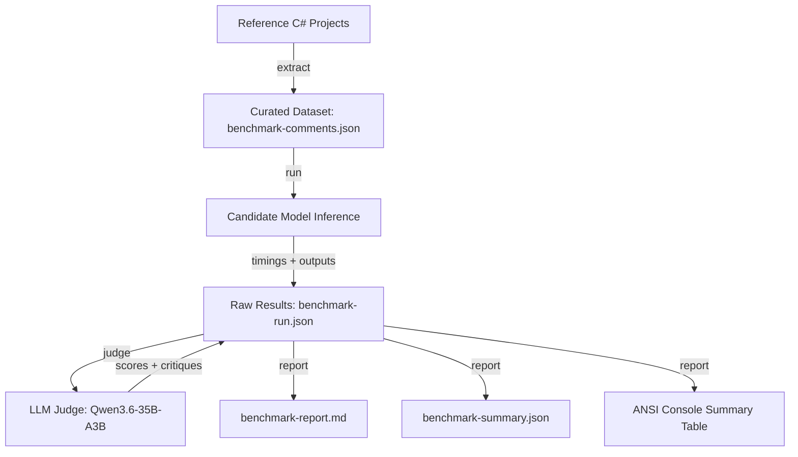

# Pmad.CodeCondenser.Benchmark

A dedicated CLI benchmark utility for evaluating, ranking, and selecting local Ollama LLMs for C# code comment summarization in **Pmad.CodeCondenser**.

---

## Overview

`Pmad.CodeCondenser.Benchmark` provides a rigorous, automated pipeline to test candidate models on real-world C# comments extracted directly from reference open-source codebases. It measures both **computational performance** (latency, tokens/second, memory stability) and **qualitative output** (accuracy, conciseness, format compliance) using an LLM-as-a-judge approach.

### Key Features

- **Roslyn AST Comment Extraction**: Scans C# source trees to extract verbose regular comments (`//`, `/* */`) and XML documentation tags (`/// <summary>`, `/// <remarks>`, `/// <param>`).
- **Standardized Prompts**: Uses the exact production prompts from `Pmad.CodeCondenser.Infrastructure.Llm.Prompts`.
- **Reasoning Suppression (`think: false`)**: Automatically disables internal thinking monologue on reasoning models (e.g., Qwen 3.5) to ensure instant, concise summaries without fluff.
- **Context Window Configuration (`num_ctx`)**: Configurable context size (defaults to **24,576 tokens / 24k**) matching production settings.
- **LLM-as-a-Judge Evaluation**: Uses a larger, impartial reference model (default: `Qwen3.6-35B-A3B:latest`) with temperature `0.0` to grade summaries on Technical Accuracy, Conciseness, and Format Compliance.
- **Model-Batched Execution**: Iterates model-by-model so Ollama loads each model into VRAM only once, avoiding repetitive model swaps.
- **Continuous Checkpointing & Resumption**: Results are saved to disk after every single generation; interrupted runs can be resumed instantly with `--resume`.
- **Comprehensive Reporting**: Generates interactive ANSI terminal tables, detailed Markdown reports with side-by-side qualitative comparisons, and machine-readable JSON summaries.

---

## Architecture & Workflow



---

## Prerequisites

1. **Ollama**: Running locally. The utility auto-detects `OLLAMA_HOST` (e.g. `http://127.0.0.1:11435`) or defaults to `http://localhost:11434`.
2. **Candidate Models**: Pulled into local Ollama:
   ```bash
   ollama pull gemma4:e4b
   ollama pull qwen3.5:4b
   ollama pull qwen3.5:2b
   ollama pull Qwen3.5-4B:latest
   ollama pull gemma4:e2b
   ```
3. **Judge Model**:
   ```bash
   ollama pull Qwen3.6-35B-A3B:latest
   ```
4. **.NET 10 SDK**: Required to build and run the tool.

---

## Commands

Run the CLI using `dotnet run --project src/Pmad.CodeCondenser.Benchmark -- <command> [options]`.

| Command | Alias | Description |
| :--- | :--- | :--- |
| `all` | | Runs the complete end-to-end pipeline: extract comments, execute benchmark on all candidates, run judge evaluations, and generate reports. (Default command) |
| `extract` | | Scans reference projects and extracts a curated, balanced set of verbose comments into `benchmark-comments.json`. |
| `run` | `bench`, `benchmark` | Runs inference for all candidate models against the dataset and executes LLM judge evaluations. |
| `judge` | | Evaluates candidate model outputs in an existing `benchmark-run.json` using the LLM judge model. Useful if candidate generation was run with `--skip-judge`. |
| `report` | | Re-computes summary statistics and regenerates the console table, Markdown report, and JSON summary from `benchmark-run.json`. |
| `help` | `-h`, `--help` | Displays command line usage and available flags. |

---

## Command-Line Options

| Option | Short | Description | Default |
| :--- | :---: | :--- | :--- |
| `--projects <paths>` | `-p` | Comma-separated list of C# project paths to scan for comments. | Preconfigured reference paths |
| `--candidates <models>` | `-c` | Comma-separated list of candidate Ollama model tags. | `gemma4:e4b,qwen3.5:4b,qwen3.5:2b,Qwen3.5-4B:latest,gemma4:e2b` |
| `--judge <model>` | `-j` | Ollama model tag for LLM-as-a-judge scoring. | `Qwen3.6-35B-A3B:latest` |
| `--endpoint <url>` | `-e` | Ollama endpoint URL. | `OLLAMA_HOST` or `http://localhost:11434` |
| `--dataset <path>` | `-d` | Path to comments dataset JSON. | `benchmark-comments.json` |
| `--output-dir <path>` | `-o` | Output directory for runs and reports. | `benchmark-output` |
| `--results <path>` | `-r` | Path to an existing `benchmark-run.json` file. | `benchmark-output/benchmark-run.json` |
| `--context-size <n>` | `--num-ctx`, `-cs` | Ollama context window size (`num_ctx`). | `24576` (24k tokens) |
| `--sample <n>` | `-s` | Stratified sample size across projects and comment kinds during extraction. | `25` |
| `--limit <n>` | `-l` | Limit the benchmark run to the first N comments in the dataset. | All comments |
| `--threshold-comments <n>` | `-tc` | Minimum comment character length for extraction. | `100` |
| `--skip-judge` | | Skip the LLM judge evaluation phase (measure speed/throughput only). | `false` |
| `--resume` | | Resume an interrupted run without recomputing completed items. | `false` |
| `--no-color` | | Disable ANSI terminal color codes in output. | `false` |
| `--help` | `-h`, `-?` | Show usage instructions. | |

---

## Usage Examples

### 1. Run the Full Benchmark on the Dataset
```bash
dotnet run --project src/Pmad.CodeCondenser.Benchmark -- run
```

### 2. Fast Speed Test (Without Judge Evaluation)
Measure latency, token throughput, and format compliance across candidate models without invoking the 35B judge:
```bash
dotnet run --project src/Pmad.CodeCondenser.Benchmark -- run --skip-judge
```

### 3. Evaluate a Subset of Comments (Smoke Test)
Run candidate inference and judge evaluation on only the first 5 comments:
```bash
dotnet run --project src/Pmad.CodeCondenser.Benchmark -- run --limit 5
```

### 4. Resume an Interrupted Benchmark
If a benchmark was stopped or interrupted, resume from the exact last saved item in `benchmark-run.json`:
```bash
dotnet run --project src/Pmad.CodeCondenser.Benchmark -- run --resume
```

### 5. Run the Judge on Existing Results
Run the 35B judge on a completed or partial `benchmark-run.json`:
```bash
dotnet run --project src/Pmad.CodeCondenser.Benchmark -- judge
```

### 6. Extract Comments from Custom Projects
```bash
dotnet run --project src/Pmad.CodeCondenser.Benchmark -- extract -p "C:\MyRepo1,C:\MyRepo2" -s 30 -o benchmark-comments.json
```

### 7. Benchmark Specific Candidate Models with Custom Context Window
```bash
dotnet run --project src/Pmad.CodeCondenser.Benchmark -- run -c "qwen3.5:4b,gemma4:e4b" --context-size 16384
```

---

## Evaluation Metrics

The benchmark produces multi-dimensional metrics for each model:

| Metric | Source | Description |
| :--- | :--- | :--- |
| **Technical Accuracy** | Judge (1-10) | Does the summary preserve technical nuance, contracts, edge cases, and parameters without hallucination? |
| **Conciseness** | Judge (1-10) | Did the model strip conversational filler and achieve high information density? |
| **Format Compliance** | Judge (1-10) & Rule Engine | For XML docs: Valid XML `<summary>`, `///` prefix on every line. For regular comments: Clean inline text without markdown code blocks. |
| **Overall Score** | Judge (1-10) | Weighted holistic score reflecting production readiness for C# codebases. |
| **Latency (ms)** | Stopwatch | End-to-end response time (average, median, P95, min, max). |
| **Tokens / Second** | Ollama telemetry | Inference generation speed computed from `eval_duration` and `eval_count`. |
| **Compression Ratio (%)** | Character counts | Percentage reduction in comment character length: `(Original - Summary) / Original * 100`. |
| **Success Rate (%)** | Execution | Percentage of requests that completed successfully without timeouts or empty outputs. |

## Latest Benchmark Results (Reference Run)

> Evaluated on 2026-10-20 using **`Qwen3.6-35B-A3B:latest`** (Temperature: `0.0`, strict multi-criteria JSON scoring) across 25 curated comments (125 candidate generations, 125 judge calls) with 24k context window and internal thinking disabled:

### Overall Rankings

| Rank | Model | Overall (/10) | Avg Latency | Median Latency | P95 Latency | Throughput | Compression | Format % | Success % |
| :---: | :--- | :---: | :---: | :---: | :---: | :---: | :---: | :---: | :---: |
| 🥇 | **`gemma4:e4b`** | **9.92** | 464 ms | **198 ms** | 499 ms | 205.8 tok/s | **20.9%** | 100% | **100%** |
| 🥈 | **`Qwen3.5-4B:latest`** | **9.90** | 365 ms | 212 ms | 507 ms | 214.3 tok/s | 16.4% | 100% | **100%** |
| 🥉 | **`qwen3.5:4b`** | **9.84** | 429 ms | 236 ms | 833 ms | 142.8 tok/s | 20.0% | 100% | **100%** |
| 4 | **`gemma4:e2b`** | **9.82** | 551 ms | **126 ms** | **319 ms** | **309.3 tok/s** | 19.7% | 100% | **100%** |
| 5 | **`qwen3.5:2b`** | **9.54** | **342 ms** | 176 ms | 641 ms | 191.9 tok/s | 13.6% | 100% | **100%** |

### Evaluation Criteria Breakdown

| Model | Overall Score | Technical Accuracy | Conciseness | Format Compliance | Recommendation |
| :--- | :---: | :---: | :---: | :---: | :--- |
| **`gemma4:e4b`** | **9.92** | **9.80** | **9.96** | **10.00** | 🏆 **Default / Top Quality** (near-perfect technical fidelity) |
| **`Qwen3.5-4B:latest`** | **9.90** | **9.80** | **9.92** | **10.00** | ⚖️ **Best Balanced** (fastest 4B model with `think: false`) |
| **`qwen3.5:4b`** | **9.84** | 9.68 | 9.92 | **10.00** | Strong XML documentation summaries |
| **`gemma4:e2b`** | **9.82** | 9.76 | 9.88 | **10.00** | Highest generation throughput (309 tok/s) |
| **`qwen3.5:2b`** | **9.54** | 9.40 | 9.72 | **10.00** | ⚡ **Fastest / Lightweight** (lowest VRAM footprint) |

---

## Output Files

All results are written to `--output-dir` (default: `benchmark-output/`):

1. **`benchmark-run.json`**:
   The full raw log containing every model response, token telemetry, latency measurement, and judge evaluation breakdown.
2. **`benchmark-report.md`**:
   A presentation-ready Markdown report including:
   - Executive Summary & Recommended Models (Top Quality, Fastest, Best Balanced).
   - Global ranking table sorted by overall quality and throughput.
   - Breakdown by comment kind (XML Documentation vs. Regular comments).
   - Side-by-side qualitative comparisons showing original comments and model-generated summaries with judge critiques.
3. **`benchmark-summary.json`**:
   Machine-readable summary statistics per model (averages, medians, P95, success counts, category metrics).
